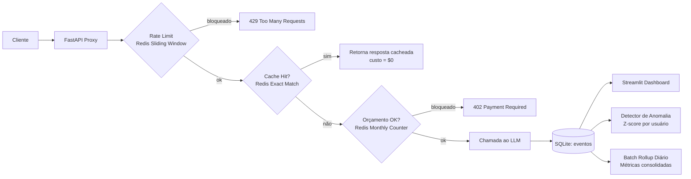

# 🛡️ AI Cost Guard

**Um proxy de observabilidade e governança de custos para chamadas de LLM.**
Intercepta requisições de IA em tempo real, aplica *rate limiting*, cache e orçamento por usuário, e expõe tudo em um dashboard de FinOps — com detecção de anomalias e agregação em lote.

> Projeto de portfólio construído para demonstrar raciocínio de arquitetura de sistemas e engenharia de dados aplicados a um problema real: **controle de custo de IA em escala**.

---

## O problema que isso resolve

Times que usam LLMs em produção enfrentam três riscos financeiros e operacionais recorrentes:

1. **Custo sem visibilidade** — ninguém sabe quanto cada usuário/time está gastando até a fatura chegar.
2. **Abuso de API** — um usuário (ou um bug em loop) pode disparar milhares de requisições sem controle.
3. **Desperdício** — a mesma pergunta é enviada ao modelo repetidas vezes, pagando o mesmo custo de novo.

O **AI Cost Guard** ataca os três ao mesmo tempo, como uma camada de proxy entre a aplicação e o provedor de LLM.

---

## Arquitetura



### Pipeline de decisão (ordem importa — *fail fast*)

| Ordem | Camada | Por quê nessa posição |
|---|---|---|
| 1 | **Rate Limit** | Checagem mais barata (só conta requisições). Rejeita abuso antes de gastar processamento com qualquer outra lógica. |
| 2 | **Cache** | Se já existe resposta, nem faz sentido checar orçamento — o custo já é zero. |
| 3 | **Budget** | Só verifica gasto se a requisição realmente vai custar dinheiro de verdade. |

### Stack atual (desenvolvimento local)

- **FastAPI** — proxy assíncrono
- **Redis** — cache exato (SHA-256), rate limiting (sliding window log), orçamento mensal por usuário
- **SQLite** — persistência de eventos e métricas consolidadas
- **Streamlit + Plotly** — dashboard de observabilidade

### Evolução planejada para produção em escala

| Componente atual | Substituiria por | Motivo |
|---|---|---|
| SQLite | **PostgreSQL + TimescaleDB** | SQLite serializa escrita (lock de arquivo) — testado sob carga concorrente, ver seção de benchmarks abaixo. TimescaleDB oferece *continuous aggregates* nativos para séries temporais. |
| Escrita síncrona de log | **Apache Kafka** | Desacopla a latência do proxy da latência de persistência — o proxy publica o evento e responde ao cliente sem esperar a escrita em disco (padrão **CQRS**). |
| Cache exato (hash) | **Cache semântico (embeddings)** | Detectaria perguntas parecidas ("explica bayes" vs "o que é teorema de bayes"), não só idênticas — usando `pgvector` ou busca vetorial no Redis. |

---

## Resultados de um stress test real

Rodei um simulador de tráfego assíncrono (`stress_test.py`, usando `asyncio` + `aiohttp`) disparando **500 requisições concorrentes** contra o proxy, simulando 20 usuários (incluindo um usuário deliberadamente abusivo).

| Métrica | Valor |
|---|---|
| Requisições processadas | 477 |
| Custo total simulado | $0.79 |
| Taxa de cache hit | 23.5% |
| Requisições bloqueadas (rate limit + orçamento) | 68 |
| Anomalias de gasto detectadas (z-score) | 26 |

**Achado interessante:** sob carga concorrente, a latência p95 subiu de ~400ms (comportamento normal) para **~4.600ms**. Isso não é um bug — é a prova prática do gargalo do SQLite sob escrita concorrente (lock a nível de arquivo), e é exatamente o que justifica a migração para PostgreSQL/Kafka na tabela de evolução acima. Prefiro documentar o gargalo real a escondê-lo.

*(Screenshots do dashboard: adicionar aqui ``)*

---

## Funcionalidades

- ✅ **Rate limiting** com sliding window log no Redis (sem o bug clássico do fixed window na virada de janela)
- ✅ **Cache exato** por hash SHA-256 de `modelo + prompt`, com TTL configurável
- ✅ **Circuit breaker de orçamento** — reserva de custo estimado *antes* da chamada ao LLM, com reconciliação após a resposta real
- ✅ **Detector de anomalia** — z-score por usuário sobre o histórico de gastos individual (não um limite fixo global)
- ✅ **Batch rollup diário** — agregação de métricas em lote (padrão *materialized aggregate*, o mesmo princípio por trás de `dbt` e das *continuous aggregates* do TimescaleDB), com UPSERT idempotente
- ✅ **Dashboard de observabilidade** — custo por modelo, top usuários por gasto, latência, distribuição de status, alertas de anomalia

---

## Como rodar localmente

```bash
# 1. Sobe o Redis
docker compose up -d

# 2. Cria e ativa o ambiente virtual (Python 3.11+)
python -m venv venv
source venv/bin/activate  # Windows: venv\Scripts\Activate.ps1

# 3. Instala as dependências
pip install -r requirements.txt

# 4. Sobe o proxy
uvicorn app.main:app --reload

# 5. Em outro terminal, sobe o dashboard
streamlit run dashboard/streamlit_app.py

# 6. (Opcional) Gera tráfego de teste
python stress_test.py --requests 500 --concurrency 50
```

Testando o endpoint principal:

```bash
curl -X POST http://127.0.0.1:8000/v1/chat/completions \
  -H "Content-Type: application/json" \
  -d '{"user_id": "thalyson", "model": "gpt-4o", "prompt": "oi tudo bem", "max_tokens": 256}'
```

---

## 📁 Estrutura do projeto

```
ai-cost-guard/
├── app/
│   ├── main.py          # Proxy FastAPI — orquestra o pipeline de decisão
│   ├── pricing.py        # Tabela de preços e estimativa de custo/tokens
│   ├── cache.py           # Cache exato via Redis (SHA-256)
│   ├── rate_limit.py     # Sliding window log via Redis
│   ├── budget.py          # Circuit breaker de orçamento mensal
│   ├── anomaly.py         # Detector de anomalia por z-score
│   ├── aggregate.py       # Batch rollup diário (métricas consolidadas)
│   └── database.py        # Persistência SQLite
├── dashboard/
│   └── streamlit_app.py  # Dashboard de observabilidade
├── stress_test.py          # Simulador de tráfego assíncrono
├── docker-compose.yml      # Redis local
└── requirements.txt
```

---

## Decisões de design

- **Por que a estimativa de custo assume o pior caso** (usa `max_tokens` inteiro): em um circuit breaker financeiro, é preferível superestimar e bloquear em segurança do que subestimar e deixar passar gasto descontrolado.
- **Por que o orçamento é reservado *antes* da chamada real ao LLM**: evita uma *race condition* onde múltiplas requisições paralelas poderiam "passar" na checagem de orçamento simultaneamente, antes que qualquer uma tivesse atualizado o total gasto.
- **Por que o detector de anomalia usa baseline por usuário, não um limite global**: um usuário que sempre gasta $1/requisição não é anômalo gastando $1.20; um usuário que sempre gasta $0.001 e de repente gasta $0.05 é uma anomalia real, mesmo sendo um valor absoluto menor. O que importa é o desvio do padrão histórico individual.

---

## 📌 Próximos passos

- [ ] Migrar persistência para PostgreSQL + TimescaleDB
- [ ] Desacoplar escrita de eventos via Apache Kafka
- [ ] Cache semântico com embeddings (`pgvector` ou busca vetorial)
- [ ] Automatizar o batch rollup diário via `APScheduler` (hoje é manual/on-demand)

---

## 👤 Autor

**Thalison Bruno Reis dos Santos** — estudante de Ciência da Computação, foco em Engenharia de Dados
[GitHub](https://github.com/thalisondev) · [LinkedIn](https://linkedin.com/in/thalison-dev)